<p align="center">
  
</p>

<p align="center">
  <b>Authorized security assessment framework for IP cameras, NVRs and DVRs.</b><br>
  Fingerprint the device, correlate it to the weaknesses that actually apply, verify them,
  and hand back a report you can give to a client.
</p>

---

## What it does

Pointing a generic web scanner at a camera gives you noise. KAMSTRIKE identifies the device
first, then tests only what that device is plausibly affected by.

```
targets → authorization gate → port scan → fingerprint → correlate
        → vendor checks → nuclei templates → media & surface discovery → report
```

The correlation step is the point. A Hikvision camera is never tested with Dahua payloads,
and a 30-host sweep does not turn into 50,000 pointless requests.

- **26 vendors** fingerprinted from HTTP headers, auth realms, page titles, bodies, cookies,
  probe paths, RTSP banners and ONVIF replies — with the evidence recorded so a reviewer can
  audit the call.
- **29 knowledge-base entries** covering **25 CVEs**, each mapped to a local verification
  check, a nuclei template, or both.
- **20 verification checks** that prove a weakness rather than guessing from a banner.
- **15 bundled nuclei templates**, plus automatic use of your own template store.
- **114 factory-default credential pairs**, vendor-ordered and lockout-aware.
- **Media discovery** across RTSP, RTMP, HTTP MJPEG, HLS, snapshot and MMS.
- **Screenshots** of device web interfaces, **IP intelligence**, and OSINT pivot links.
- **Reports** in JSON, CSV, Markdown and a self-contained HTML file.
- **A web dashboard** with a live view, an exploit catalogue and scan launching.

Vendors covered include Hikvision, Dahua, Axis, Vivotek, GeoVision, Xiongmai, TVT, TBK,
Avtech, Foscam, Reolink, D-Link, NUUO, Uniview, Hanwha, Bosch, Panasonic, Sony, Mobotix,
Trendnet, Vstarcam, Ubiquiti, Honeywell, Milesight, ACTi and the GoAhead/Boa/uc-httpd OEM
platforms that sit behind a very large share of white-label gear.

## Authorization

KAMSTRIKE exercises real vulnerabilities against real devices. Every run has to say who
authorized it and against what scope, and the gate is deliberately impossible to satisfy by
accident:

- `--authorized` (or `KAMSTRIKE_AUTHORIZED=1`) is required; there is no default-on path.
- Targets outside private address space are refused unless you supply `--scope-file` or
  `--allow-public`.
- Sweeps above 4096 hosts are refused unless you pass `--allow-large`.
- Every run writes `engagement.json` recording operator, scope, reference and timestamp.

Nothing destructive ships: no reboots, no configuration writes, no password changes, no
denial of service. Verification is read-only by default. Checks that must change device state
to prove anything are marked `intrusive` in the knowledge base and only run under
`--exploit`, which reports any artefact it leaves behind so you can clean it up.

## Install

```bash
git clone https://github.com/karim852/KAMSTRIKE
cd KAMSTRIKE
pip install -e .
```

Optional but recommended:

```bash
# nuclei, for the template stage
go install github.com/projectdiscovery/nuclei/v3/cmd/nuclei@latest

# node + playwright, for screenshots
npm install playwright && npx playwright install chromium
```

Both are optional. Without nuclei the local checks still run; without node the screenshot
stage is skipped and says so.

## Use

```bash
# a subnet, with the default quick port profile
kamstrike scan 192.168.1.0/24 --authorized --auth-ref ENG-2214

# one device, every known camera port, full output set
kamstrike scan 10.0.5.10 --authorized --profile full --screenshots --format html,json,csv

# a client engagement, held to a written scope
kamstrike scan 203.0.113.0/24 --authorized --scope-file scope.txt --auth-ref SOW-114

# verify one specific issue, allowing state-changing proof
kamstrike scan 192.168.1.64 --authorized --only hikvision-webdav-rce --exploit

# quiet, high-signal sweep for a large estate
kamstrike scan 10.0.0.0/22 --authorized --min-severity high --no-creds -q
```

Port profiles: `quick` (10 ports), `standard` (131), `full` (202), `wide` (536 — for OEM
firmware that parks its interface on an arbitrary high port).

Reference commands:

```bash
kamstrike vendors              # the fingerprint database
kamstrike kb --vendor Dahua    # what applies to a vendor, and how it is verified
kamstrike kb --cve CVE-2018-9995
kamstrike checks               # the verification checks and their knowledge-base entries
kamstrike templates            # bundled templates and nuclei status
kamstrike targets 10.0.0.1-50  # expand a target spec without scanning anything
```

## Dashboard

```bash
kamstrike serve                      # http://127.0.0.1:8787
kamstrike serve --results ~/engagements/acme
```

Five views: **Scans** (devices, findings, engagement record, report downloads), **Live &
shots** (MJPEG and snapshot feeds rendered in the browser, RTSP/RTMP with a player command to
copy, plus the screenshot wall), **Exploits** (the full catalogue, filterable by vendor, CVE,
severity, intrusiveness and in-the-wild status), **New scan**, and **Vendors**.

It is stdlib-only — no build step, no CDN, no outbound requests — so it works on an isolated
assessment network. It binds to loopback by default, mutating endpoints require the token
printed at startup, and the authorization gate applies to scans launched from the UI exactly
as it does on the command line.

## Output

```
kamstrike-out/
├── engagement.json     who authorized this run, over what scope, when
├── report.json         the full machine-readable result
├── report.html         self-contained, dark, shareable
├── report.md           for a wiki or a pull request
├── findings.csv        for a spreadsheet or a tracker
├── screenshots/        device web interfaces
└── nuclei/             the template stage's raw output
```

Every finding carries a **confidence**: `confirmed` means the weakness was exercised and the
response proved it; `likely` means a signature matched; `possible` means the device is in
scope for the issue but it was not verified — those are labelled `[unverified]` in the report
and are never presented as proven. Findings that a local check and a nuclei template both
confirm are merged and marked as corroborated.

## Knowledge base

`kamstrike/data/kb.yaml` is the correlation layer. Each entry names the vendors and web stacks
it applies to, the CVEs, the local check that proves it, the nuclei templates that cover it,
whether verification is intrusive, and whether it is exploited in the wild. Adding coverage
means adding an entry and, if it needs one, a check function — the engine picks it up with no
other changes.

`kamstrike/data/vendors.yaml` holds the weighted fingerprint rules, and
`kamstrike/data/creds.yaml` the default-credential database. Both are plain YAML; extend them
for the estate you are working on.

## Development

```bash
pip install -e ".[dev]"
pytest                 # 113 tests, including a full pipeline run against a mock camera
ruff check kamstrike tests
```

`tests/fixtures/mock_camera.py` is a deliberately vulnerable mock Hikvision-style device. Run
it standalone (`python tests/fixtures/mock_camera.py 8080`) to exercise the tool without
touching real hardware.

## Legal

For authorized testing only. Use it on equipment you own or have written permission to assess.
Scanning or accessing devices without authorization is illegal in most jurisdictions, and
cameras in particular carry privacy obligations well beyond the usual computer-misuse rules.
The authorization gate and the engagement record exist to keep that boundary explicit — they
are not a substitute for having permission.
