<p align="center">
  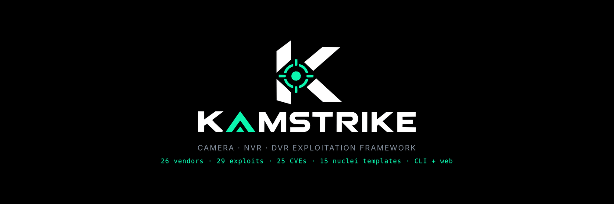
</p>

<p align="center">
  
  
  
  
  <br>
  
  
  
  
  <br>
  
  <a href="https://ko-fi.com/k0r1m"></a>
</p>

---

**KAMSTRIKE** is an offensive framework for IP cameras, NVRs and DVRs.

Point a generic web scanner at a camera and you get noise. KAMSTRIKE identifies the device
first — vendor, model, firmware, embedded web stack — then fires only the exploits that
device is actually affected by. One Hikvision camera never eats a Dahua payload, and a /24
sweep doesn't turn into 50,000 pointless requests.

- 🎯 **Vendor fingerprinting** — 26 vendors from headers, auth realms, titles, bodies, cookies, probe paths, RTSP banners and ONVIF
- 💥 **29 exploits / 25 CVEs** — Hikvision, Dahua, Axis, TBK, TVT, Xiongmai, GeoVision, D-Link, Avtech, NUUO, GoAhead OEM and more
- 🧬 **Correlation engine** — the fingerprint decides which exploits and which nuclei templates run
- 🔑 **Default credential spraying** — 114 pairs, vendor-ordered, across HTTP, RTSP and ONVIF
- 📡 **Media discovery** — RTSP, RTMP, MJPEG, HLS, snapshot and MMS, with vendor stream-URL patterns
- 📸 **Screenshots** — headless capture of every device web interface
- 🌐 **Web dashboard** — live camera wall, exploit catalogue, scan launcher. No build step, no CDN
- 🧾 **Reports** — JSON, CSV, Markdown and a self-contained dark HTML file
- 🔌 **Nuclei integration** — 15 bundled camera templates plus your own template store

```bash
git clone https://github.com/karim852/KAMSTRIKE
cd KAMSTRIKE && pip install -e .

kamstrike scan 192.168.1.0/24 --screenshots
kamstrike serve                      # dashboard on http://127.0.0.1:8787
```

<p align="center">
  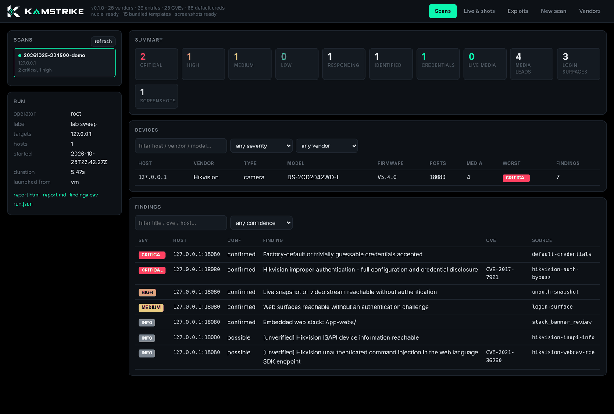
  <br><sub>The dashboard after a sweep — devices, findings, run record and report downloads.</sub>
</p>

---

## 📑 Contents

- [Install](#-install)
- [First scan](#-first-scan)
- [Terminal](#-terminal)
- [Web dashboard](#-web-dashboard)
- [Exploit catalogue](#-exploit-catalogue)
- [Modules](#-modules)
- [Reports](#-reports)
- [CLI reference](#-cli-reference)
- [Extending the knowledge base](#-extending-the-knowledge-base)
- [Testing](#-testing)
- [Ecosystem](#-ecosystem)
- [Support](#-support)

---

## 📦 Install

```bash
git clone https://github.com/karim852/KAMSTRIKE
cd KAMSTRIKE
pip install -e .
```

| Dependency | Needed for | Install |
| --- | --- | --- |
| Python 3.10+ | everything | — |
| `httpx`, `PyYAML`, `rich` | everything | installed by pip |
| **nuclei** | the template stage | `go install github.com/projectdiscovery/nuclei/v3/cmd/nuclei@latest` |
| **node + playwright** | screenshots | `npm install playwright && npx playwright install chromium` |

Both optional pieces degrade cleanly: without nuclei the built-in exploits still run, without
node the screenshot stage is skipped and says so. **No API keys, ever.**

---

## 🚀 First scan

```bash
kamstrike scan 192.168.1.0/24 --screenshots
```

<p align="center">
  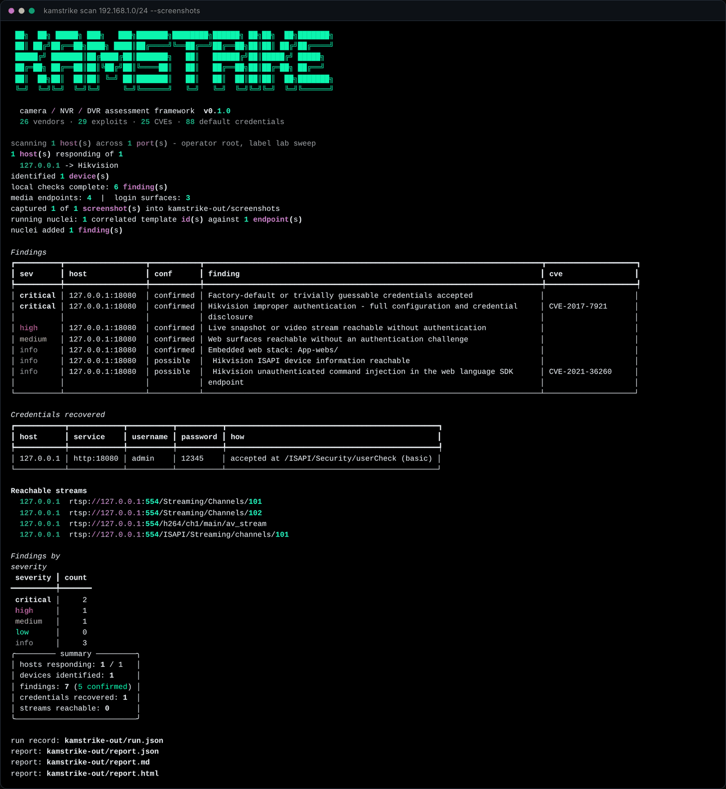
</p>

What just happened, in order:

1. **Port scan** — the `quick` profile (10 camera ports) over an async connect scan
2. **Fingerprint** — HTTP, RTSP and ONVIF probed; vendor scored against 26 weighted rule sets
3. **Correlate** — the knowledge base returns only the exploits that apply to *this* device
4. **Exploit** — local checks confirm what they can; unverifiable issues are reported as candidates, never claimed
5. **Spray** — vendor default credentials, best-guess first, lockout-aware
6. **Discover** — media endpoints, login surfaces, screenshots, OSINT pivots
7. **Nuclei** — the correlated template set runs against the live endpoints
8. **Report** — JSON, Markdown, HTML and CSV written to `kamstrike-out/`

Exit code is `1` when anything critical or high was found, so it drops straight into CI or a
cron job.

---

## 💻 Terminal

**Browse the exploit knowledge base**

```bash
kamstrike kb --vendor Hikvision
```

<p align="center">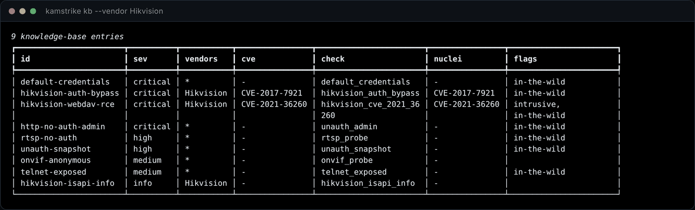</p>

**See every verification check and what it proves**

```bash
kamstrike checks
```

<p align="center">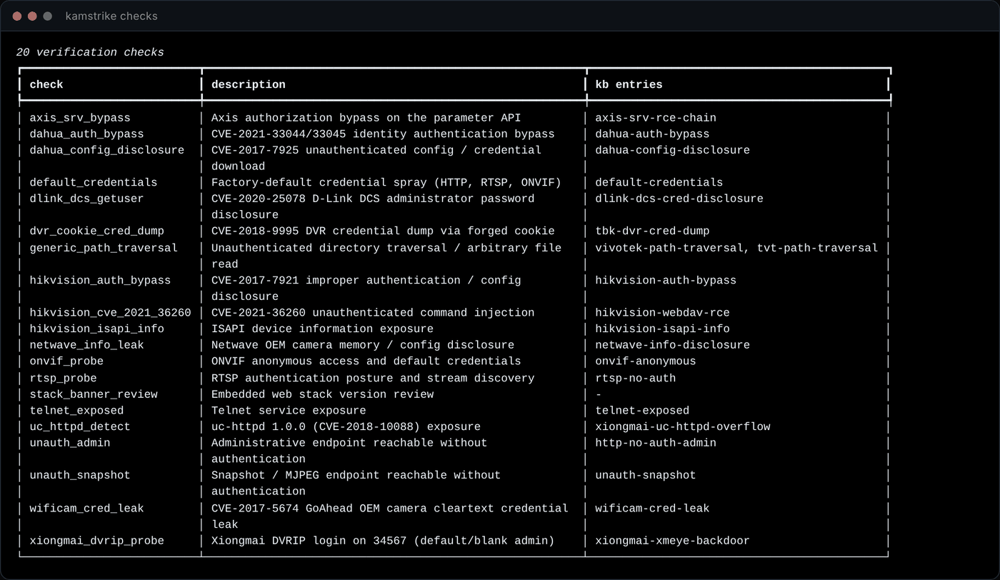</p>

**Bundled nuclei templates and engine status**

```bash
kamstrike templates
```

<p align="center">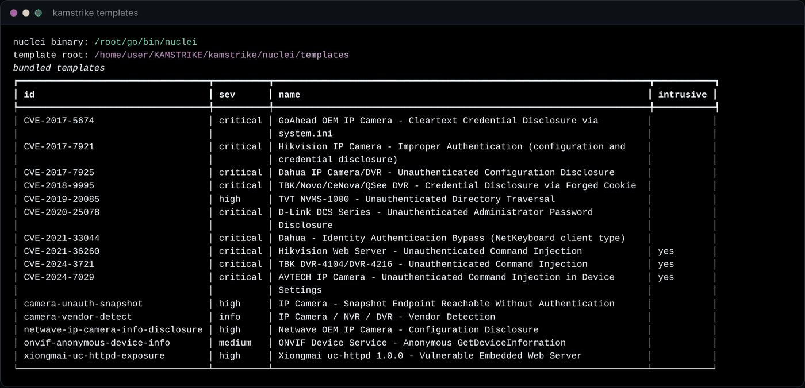</p>

**The fingerprint database**

```bash
kamstrike vendors
```

<p align="center">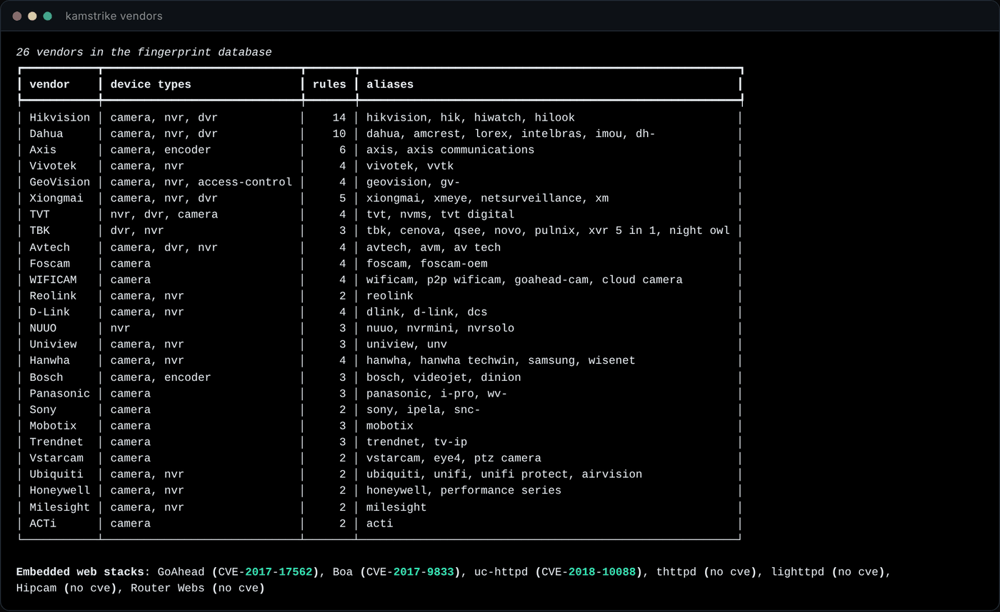</p>

---

## 🌐 Web dashboard

```bash
kamstrike serve                           # http://127.0.0.1:8787
kamstrike serve --results ~/jobs/acme     # point it at any results directory
```

Stdlib-only: no build step, no npm, no CDN, no outbound request. It runs on an air-gapped
laptop in a plant room. The token printed at startup is required to launch scans from the UI
— it protects *your* machine, nothing more.

### Live camera wall

MJPEG and snapshot feeds render straight in the browser, pulled by your browser directly from
the device. RTSP and RTMP can't play in a page, so those tiles hand you a ready `ffplay` /
`vlc` command and an `ffmpeg` one-liner to grab 10 seconds of evidence.

<p align="center">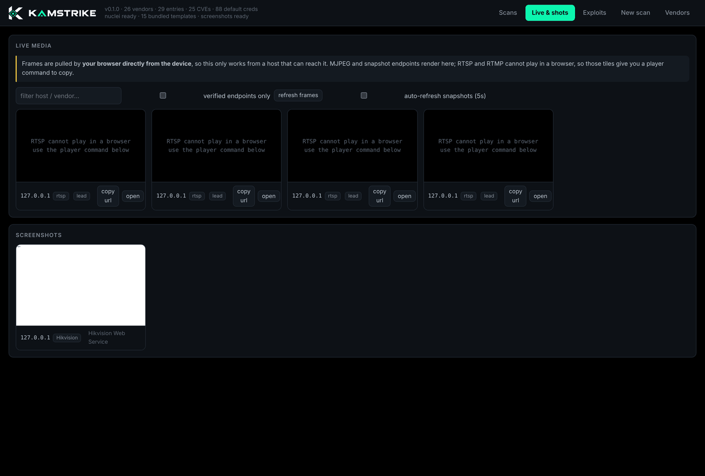</p>

### Device detail

Everything known about one box: services, recovered credentials, media endpoints, login
surfaces, IP intelligence and one-click OSINT pivots (Shodan, Censys, ZoomEye, FOFA, Netlas,
GreyNoise, Criminal IP).

<p align="center">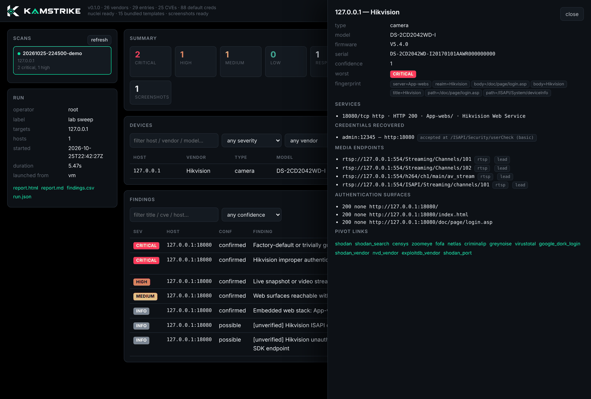</p>

### Finding detail

Every finding carries its evidence, what was matched, the exact remediation and the
structured extras the check pulled out — recovered accounts, sessions, artefacts.

<p align="center">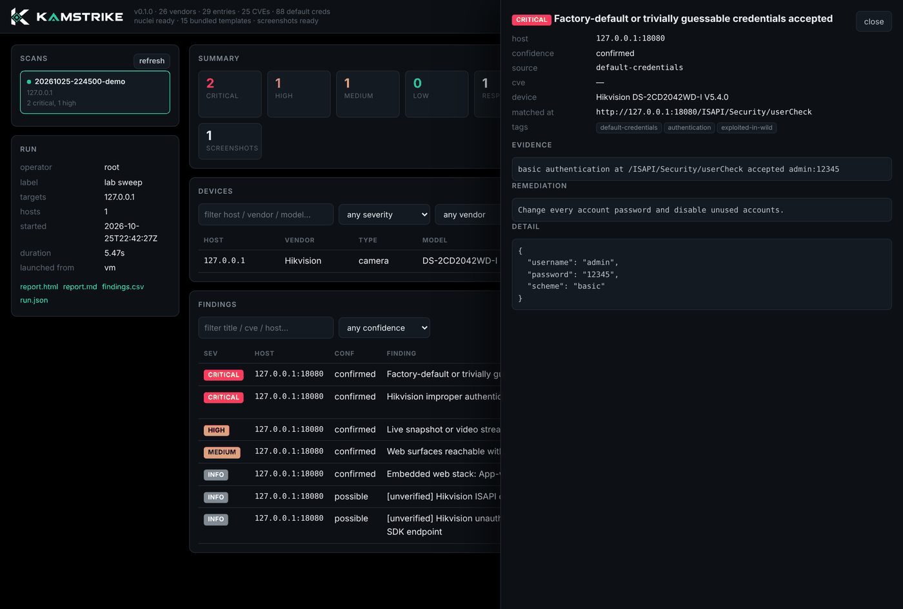</p>

### Launch scans from the browser

<p align="center">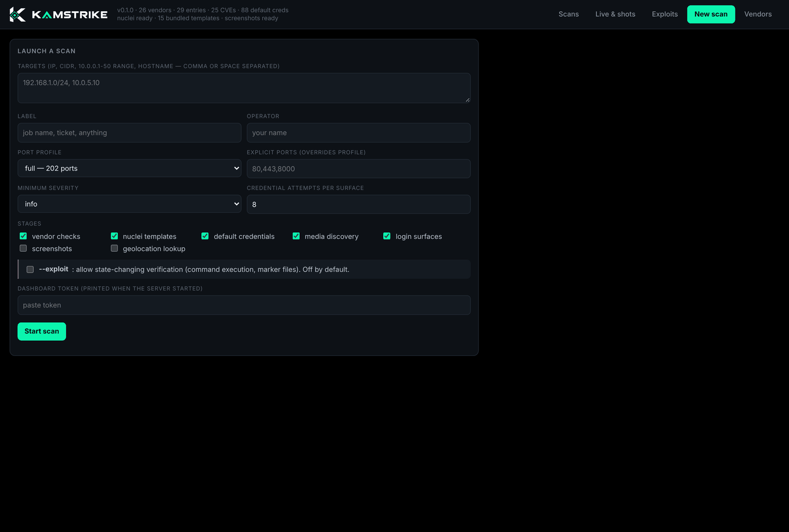</p>

---

## 💥 Exploit catalogue

Every exploit in the knowledge base, filterable by vendor, CVE, severity, intrusiveness and
whether it's being exploited in the wild right now.

<p align="center">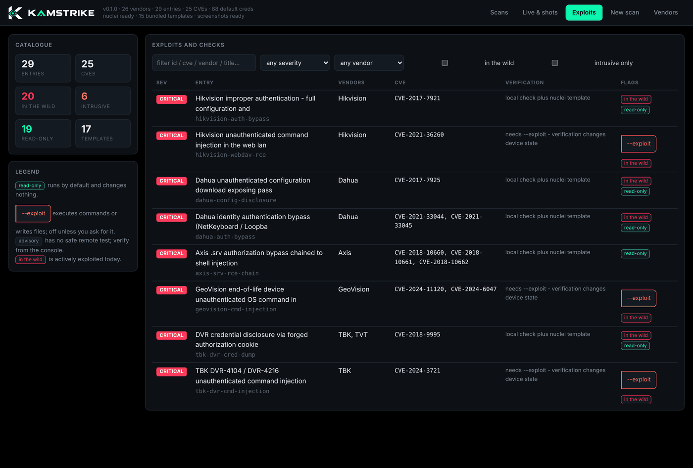</p>

Open one and you get what it is, what it affects, how KAMSTRIKE proves it, which templates
cover it, and the exact command to run just that exploit.

<p align="center">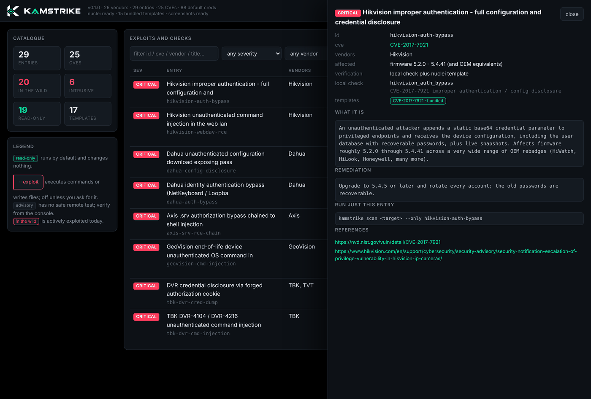</p>

### What's in the box

| Exploit | CVE | Vendors | Impact |
| --- | --- | --- | --- |
| Improper authentication | `CVE-2017-7921` | Hikvision + OEMs | config + full credential dump, unauth |
| Web language SDK injection | `CVE-2021-36260` | Hikvision | unauth RCE as root |
| Config disclosure | `CVE-2017-7925` | Dahua, Amcrest, Lorex | reversible password hashes, unauth |
| Identity auth bypass | `CVE-2021-33044/33045` | Dahua | full device control, no password |
| `.srv` authorization bypass | `CVE-2018-10660/61/62` | Axis (~390 models) | chained unauth root |
| Cookie credential dump | `CVE-2018-9995` | TBK, Novo, CeNova, QSee, Night OWL | every account in cleartext |
| Device status injection | `CVE-2024-3721` | TBK DVR-4104/4216 | unauth RCE, Mirai-adopted |
| Directory traversal | `CVE-2019-20085` | TVT NVMS | arbitrary file read, unauth |
| Factory settings injection | `CVE-2024-7029` | AVTECH | unauth RCE, CISA KEV |
| OS command injection | `CVE-2024-11120` | GeoVision EOL | unauth RCE, no patch exists |
| `system.ini` leak | `CVE-2017-5674` | GoAhead OEM (1000+ brands) | cleartext admin creds |
| CGI env poisoning | `CVE-2017-17562` | any GoAhead 2.5–3.6.5 | unauth RCE |
| uc-httpd overflow | `CVE-2018-10088` | Xiongmai platform | code execution |
| XMEye blank admin | `CVE-2017-16725` | Xiongmai | no-password admin + hidden telnet |
| `getuser` disclosure | `CVE-2020-25078` | D-Link DCS | admin password, unauth |
| Debug endpoint | `CVE-2018-1150` | NUUO NVRmini2 | account reset backdoor |
| Peekaboo overflow | `CVE-2018-1149` | NUUO NVRmini2 | unauth root |
| Netwave memory leak | — | Netwave OEM | credentials from process memory |
| ONVIF token replay | `CVE-2022-30563` | Dahua | credential replay |
| Path traversal | `CVE-2018-14786` | Vivotek | arbitrary file read |
| alphapd overflow | `CVE-2019-10999` | D-Link DCS | code execution |
| Info disclosure | `CVE-2023-3357` | GeoVision | system info, unauth |
| Default credentials | — | all | 114 pairs across HTTP, RTSP, ONVIF, DVRIP |
| Unauthenticated media | — | all | live video with no login |
| Anonymous ONVIF | — | all | model + firmware + serial |
| Open RTSP | — | all | the feed, no credentials |
| Open telnet | — | all | usually a hardcoded root shell |

Exploits that must change device state to prove anything (`CVE-2021-36260`, `CVE-2024-3721`,
`CVE-2024-7029`) are marked **intrusive** and only fire with `--exploit`. They report any
artefact they leave behind so you can clean up.

---

## 🧩 Modules

<details>
<summary><b>🔍 Port scanner</b> — async connect scan, 4 profiles up to 536 ports</summary>

<br>

Async TCP connect scan with per-service banner grabbing. Four profiles: `quick` (10 ports),
`standard` (131), `full` (202), `wide` (536 — for OEM firmware that parks its web UI on an
arbitrary high port). Covers web, RTSP, RTMP, ONVIF, DVRIP, MMS and vendor control ports.
Unrecognised open ports are probed for HTTP anyway, then demoted if nothing answers.

```bash
kamstrike scan 10.0.0.0/24 --profile wide
kamstrike scan 10.0.5.10 -p 80,443,8000-8100
```
</details>

<details>
<summary><b>🧬 Fingerprint engine</b> — 26 vendors, weighted evidence, auditable</summary>

<br>

Scores every vendor against what the device actually says: Server header, WWW-Authenticate
realm, page title, body content, Set-Cookie, vendor probe paths, RTSP banner and ONVIF reply.
The highest scorer above threshold wins, **and the reasons that got it there are kept in the
report** so a reviewer can audit the call. Embedded web stacks (GoAhead, Boa, uc-httpd,
thttpd, lighttpd) are detected separately, because the stack decides which CVEs apply
regardless of whose badge is on the plastic.

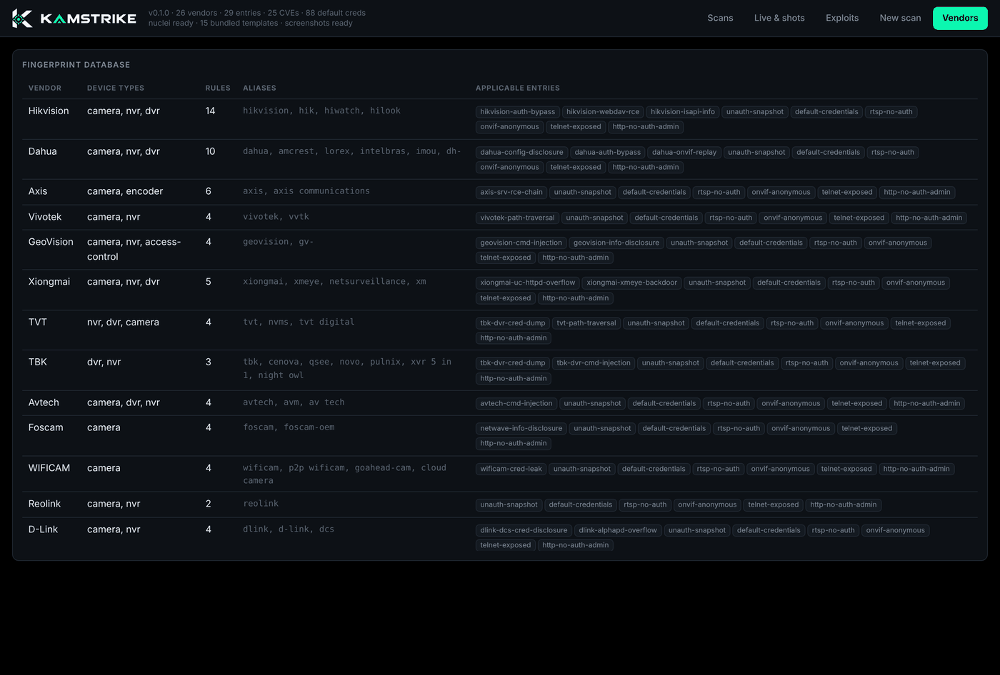
</details>

<details>
<summary><b>💥 Exploit checks</b> — 20 verification modules</summary>

<br>

Each check proves a weakness rather than guessing from a banner. They're read-only by
default: they read config, request a login, fetch a snapshot. Findings carry a confidence —
`confirmed` means it was exercised and the response proved it, `possible` means the device is
in scope but it wasn't verified, and those are labelled `[unverified]` and never presented as
proven.

```bash
kamstrike scan 10.0.5.10 --only hikvision-auth-bypass
kamstrike scan 10.0.5.10 --skip default-credentials
kamstrike scan 10.0.5.10 --exploit            # allow state-changing proof
```
</details>

<details>
<summary><b>🔑 Credential spraying</b> — 114 pairs, lockout-aware</summary>

<br>

Vendor-specific pairs first (Hikvision `admin:12345`, Axis `root:pass`, Mobotix
`admin:meinsm`, Dahua `888888:888888`…), then the generic list. Camera firmware locks accounts
after a handful of failures, so the budget is small by default (`--cred-attempts`, default 8
per surface), attempts are paced, the spray stops at the first hit, and a lockout response
aborts the host immediately. Sprays HTTP Basic/Digest, RTSP and ONVIF WS-UsernameToken; the
Mirai telnet list ships separately.

```bash
kamstrike scan 10.0.5.10 --cred-attempts 16 --cred-delay 1.0
```
</details>

<details>
<summary><b>📡 Media discovery</b> — RTSP, RTMP, MJPEG, HLS, snapshot, MMS</summary>

<br>

The point of a camera assessment is whether the video is reachable. RTSP paths are DESCRIBEd
(51 known paths, vendor-ordered) with and without default credentials; RTMP gets a real
handshake; HTTP MJPEG, HLS and snapshot endpoints are fetched and content-verified so an
error page rendered as a 200 doesn't count as a stream. Endpoints that can't be opened from
here are still recorded as vendor-pattern **leads** for an operator with credentials.


</details>

<details>
<summary><b>📸 Screenshot capture</b> — headless Chromium, out of process</summary>

<br>

Fastest way to tell a camera from a printer, and the cheapest evidence that a login page is
wide open. Runs in a separate Node/Playwright process so a hung or crashed browser can't take
the scan with it; self-signed certs and auth dialogs are handled, and a page that times out
mid-render still gets captured.

```bash
kamstrike scan 192.168.1.0/24 --screenshots --screenshot-timeout 20
```
</details>

<details>
<summary><b>🔓 Login surface enumeration</b> — every web root, not just the pretty one</summary>

<br>

These devices expose several web roots at once — a main UI, a legacy CGI tree, an SDK
endpoint, an ONVIF service — and they are frequently not protected consistently. One
unprotected surface is enough. 26 paths probed per web service, each classified as
basic / digest / form / none.
</details>

<details>
<summary><b>🛰️ ONVIF</b> — the richest recon surface on modern cameras</summary>

<br>

`GetDeviceInformation` returns manufacturer, model, firmware build and serial — and a lot of
firmware answers it unauthenticated. With credentials it also yields exact stream URIs, which
beats brute-forcing RTSP paths. Full WS-Security UsernameToken (PasswordDigest) support.
</details>

<details>
<summary><b>🌍 IP intelligence &amp; OSINT pivots</b></summary>

<br>

Pivot links are pure string building — Shodan, Censys, ZoomEye, FOFA, Netlas, Criminal IP,
GreyNoise, VirusTotal, Google dorks, NVD and Exploit-DB per CVE — so they always work, even
offline. Geolocation/ASN lookup is opt-in with `--geoip` (one outbound request per host,
skipped for private addresses) and ships map links for the hosts it resolves.

```bash
kamstrike scan 203.0.113.10 --geoip
kamstrike scan 203.0.113.10 --geoip --geoip-url "https://your-internal/api/{ip}"
```
</details>

<details>
<summary><b>🔌 Nuclei engine</b> — correlated, not carpet-bombed</summary>

<br>

KAMSTRIKE doesn't reimplement nuclei, it drives it. The fingerprint decides which templates
are worth running, so a Hikvision camera isn't tested with Dahua templates. 15 camera
templates ship with the tool (all validate against nuclei v3); your own ProjectDiscovery
store is picked up automatically. Intrusive templates are excluded unless `--exploit` is set.
A template and a local check that confirm the same CVE are **merged and marked corroborated**
rather than double-counted.


</details>

---

## 🧾 Reports

```
kamstrike-out/
├── run.json          who ran it, against what, when
├── report.json       full machine-readable result
├── report.html       self-contained, dark, shareable
├── report.md         for a wiki or a PR
├── findings.csv      for a spreadsheet or a tracker
├── screenshots/      device web interfaces
└── nuclei/           raw template-stage output
```

<p align="center">
  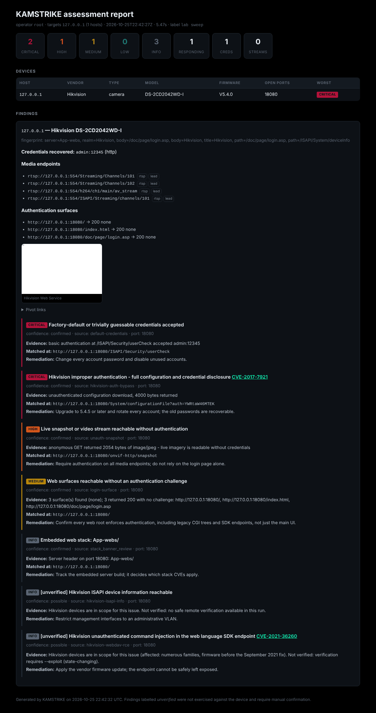
  <br><sub>The standalone HTML report — one file, no assets, drop it in an email.</sub>
</p>

---

## ⌨️ CLI reference

```
kamstrike scan <targets>     scan and exploit
kamstrike serve              web dashboard
kamstrike kb                 browse the exploit knowledge base
kamstrike checks             list verification modules
kamstrike templates          bundled nuclei templates + engine status
kamstrike vendors            fingerprint database
kamstrike targets            expand a target spec without scanning
```

| Flag | Does |
| --- | --- |
| `--profile quick\|standard\|full\|wide` | port profile (10 / 131 / 202 / 536 ports) |
| `-p, --ports 80,8000-8100` | explicit ports, overrides the profile |
| `--exploit` | allow state-changing verification |
| `--only ID,ID` / `--skip ID,ID` | restrict or exclude knowledge-base entries |
| `--screenshots` | capture device web interfaces |
| `--geoip` | geolocation / ASN lookup |
| `--no-creds` `--no-nuclei` `--no-streams` `--no-login-discovery` | drop a stage |
| `--cred-attempts N` `--cred-delay S` | credential spray budget and pacing |
| `--min-severity high` | drop everything below a severity |
| `--format json,md,html,csv` | report formats |
| `-c, --concurrency` `--host-parallelism` `-t, --timeout` `--rate-delay` | pacing |
| `--proxy http://127.0.0.1:8080` | route HTTP through Burp or similar |
| `--label TEXT` `--operator NAME` | recorded in the run record |

Targets accept IPs, CIDRs (`10.0.0.0/22`), dash ranges (`10.0.0.1-50`, `10.0.0.1-10.0.3.7`),
hostnames, pasted URLs, and `-f targets.txt`.

---

## 🧠 Extending the knowledge base

`kamstrike/data/kb.yaml` is the correlation layer. Add an entry and the engine picks it up —
no other changes:

```yaml
- id: acme-cam-auth-bypass
  cves: [CVE-2025-00000]
  vendors: [Acme]
  severity: critical
  title: Acme camera authentication bypass
  description: >
    What it is and why it matters.
  check: acme_auth_bypass        # a function in kamstrike/checks/
  nuclei: [CVE-2025-00000]       # template ids, bundled or from your store
  intrusive: false
  wild: true
  remediation: Upgrade firmware and rotate credentials.
  references: [https://nvd.nist.gov/vuln/detail/CVE-2025-00000]
```

`vendors.yaml` holds the weighted fingerprint rules and `creds.yaml` the default-credential
database. All plain YAML — extend them for the estate you're working on.

---

## 🧪 Testing

```bash
pip install -e ".[dev]"
pytest                          # 111 tests
ruff check kamstrike tests
```

`tests/fixtures/mock_camera.py` is a deliberately vulnerable mock Hikvision-style device
(CVE-2017-7921, default credentials, open snapshot). Run it standalone to exercise the tool
without touching hardware:

```bash
python tests/fixtures/mock_camera.py 8080
kamstrike scan 127.0.0.1 -p 8080
```

---

## 🌐 Ecosystem

| Project | What it does |
| --- | --- |
| [**KUMO**](https://github.com/karim852/KUMO-Domain-Recon-Tool) | Domain OSINT and recon framework — 29 modules, CLI + web |
| [**Kumo Recon**](https://github.com/karim852/kumo-recon-browser-extension) | Browser extension for recon on the site you're looking at |
| [**Kage**](https://github.com/karim852/Kage-DFIR-toolkit) | Windows host triage and DFIR toolkit |
| **KAMSTRIKE** | Camera, NVR and DVR exploitation — you are here |

---

## ❤️ Support

If KAMSTRIKE saved you a long night in a plant room, you can buy me a coffee:

<p align="center">
  <a href="https://ko-fi.com/k0r1m">
    
  </a>
</p>

---

**For legal use only.** KAMSTRIKE fires real exploits at real devices. Use it on equipment you
own or have been engaged to test. Cameras carry privacy obligations well beyond the usual
computer-misuse rules — the people in frame are not your client. The author accepts no
liability for misuse.

`ip-camera` `cctv` `nvr` `dvr` `rtsp` `onvif` `hikvision` `dahua` `camera-security`
`vulnerability-scanner` `exploitation-framework` `penetration-testing` `red-team` `iot-security`
`nuclei` `cve` `default-credentials` `osint` `recon` `security-tools` `python`

<p align="center"><sub>Built by <a href="https://github.com/karim852">karim852</a> · MIT</sub></p>
