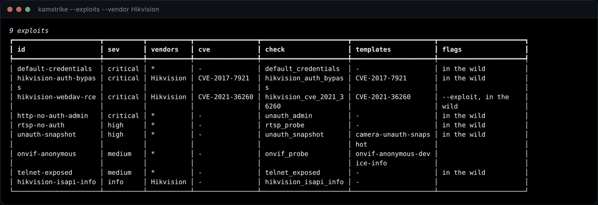

<p align="center">
  
</p>

<p align="center">


<a href="https://ko-fi.com/k0r1m"></a>
</p>

---

Give Kamstrike a camera, a recorder or a whole subnet and it works out what the device is
before it touches it: **vendor, model, firmware and embedded web stack** from HTTP, RTSP and
ONVIF. Then it runs only what that device is actually affected by — **29 exploits across 25
CVEs**, **114 factory-default credentials**, **21 templates**, and media discovery over RTSP,
RTMP, MJPEG, HLS and snapshot. Every finding carries its evidence, and anything it could not
prove is labelled unverified rather than claimed.

Nothing to install beyond three Python packages. No API key, no external scanner, no template
downloads.

```bash
pip install httpx pyyaml rich

python3 kamstrike.py 192.168.1.0/24       # scan a subnet
python3 kamstrike.py --web                # web dashboard → http://127.0.0.1:8787
python3 kamstrike.py --exploits           # everything it can find, and how
```

<p align="center">
  
  <br><sub>The dashboard after a sweep: devices, findings, run record and report downloads.</sub>
</p>

---

## 📑 Contents

- [Install](#-install)
- [First scan](#-first-scan)
- [Terminal](#-terminal)
- [Web dashboard](#-web-dashboard)
- [Exploits](#-exploits)
- [Modules](#-modules)
- [Reports](#-reports)
- [CLI reference](#-cli-reference)
- [Knowledge base](#-knowledge-base)
- [Testing](#-testing)
- [Ecosystem](#-ecosystem)

---

## 📦 Install

```bash
git clone https://github.com/karim852/KAMSTRIKE
cd KAMSTRIKE
pip install httpx pyyaml rich

python3 kamstrike.py --help
```

Or install it as a command:

```bash
pip install -e .
kamstrike 192.168.1.0/24
```

| | Needed for | Install |
| --- | --- | --- |
| Python 3.10+ | everything | — |
| `httpx` `pyyaml` `rich` | everything | `pip install httpx pyyaml rich` |
| node + playwright | screenshots only | `npm install playwright && npx playwright install chromium` |

Screenshots are the only optional piece, and the scan says so and carries on without it.

---

## 🚀 First scan

```bash
python3 kamstrike.py 192.168.1.0/24 --screenshots
```

<p align="center">
  
</p>

What it did, in order:

1. **Port scan** — the `quick` profile, 10 camera ports, async connect scan
2. **Fingerprint** — HTTP, RTSP and ONVIF probed, vendor scored against 26 weighted rule sets
3. **Correlate** — the knowledge base returns only what applies to *this* device
4. **Exploit** — built-in checks confirm what they can; anything unproven is flagged, not claimed
5. **Spray** — vendor default credentials, best-guess first, lockout-aware
6. **Discover** — media endpoints, login surfaces, screenshots, OSINT pivots
7. **Templates** — the correlated template set runs in-process against the live endpoints
8. **Report** — JSON, Markdown, HTML and CSV in `kamstrike-out/`

Exit code is `1` when anything critical or high was found, so it drops straight into CI.

---

## 💻 Terminal

**What it can find, and how it proves it**

```bash
python3 kamstrike.py --exploits
python3 kamstrike.py --exploits --vendor Hikvision
python3 kamstrike.py --exploits --cve CVE-2018-9995 --details
```

<p align="center"></p>

**The template library**

```bash
python3 kamstrike.py --templates
```

<p align="center"></p>

**The verification modules**

```bash
python3 kamstrike.py --checks
```

<p align="center"></p>

**The fingerprint database**

```bash
python3 kamstrike.py --vendors
```

<p align="center"></p>

---

## 🌐 Web dashboard

```bash
python3 kamstrike.py --web                         # http://127.0.0.1:8787
python3 kamstrike.py --web --results ~/jobs/acme   # watch any results directory
```

Stdlib only — no build step, no npm, no CDN, no outbound request. It runs on a laptop with no
internet in a plant room. The token printed at startup is needed to launch scans from the UI;
it protects the machine running the dashboard.

### Live camera wall

MJPEG and snapshot feeds render in the page, pulled by your browser straight from the device.
RTSP and RTMP can't play in a browser, so those tiles hand you a ready `ffplay` / `vlc`
command and an `ffmpeg` one-liner to grab ten seconds of evidence.

<p align="center"></p>

### Device detail

Everything known about one box: services, recovered credentials, media endpoints, login
surfaces, IP intelligence and one-click pivots to Shodan, Censys, ZoomEye, FOFA, Netlas,
GreyNoise and Criminal IP.

<p align="center"></p>

### Finding detail

Evidence, what matched, the remediation, and whatever the check pulled out — recovered
accounts, sessions, artefacts left behind.

<p align="center"></p>

### Launch scans from the browser

<p align="center"></p>

---

## 💥 Exploits

Filterable by vendor, CVE, severity, intrusiveness and whether it is being exploited in the
wild right now.

<p align="center"></p>

Open one and you get what it is, what it affects, how Kamstrike proves it, which templates
cover it, and the command to run just that one.

<p align="center"></p>

| Exploit | CVE | Vendors | Impact |
| --- | --- | --- | --- |
| Improper authentication | `CVE-2017-7921` | Hikvision + OEMs | config and full credential dump, unauth |
| Web language SDK injection | `CVE-2021-36260` | Hikvision | unauth RCE as root |
| Config disclosure | `CVE-2017-7925` | Dahua, Amcrest, Lorex | reversible password hashes, unauth |
| Identity auth bypass | `CVE-2021-33044/33045` | Dahua | full device control, no password |
| `.srv` authorization bypass | `CVE-2018-10660/61/62` | Axis (~390 models) | chained unauth root |
| Cookie credential dump | `CVE-2018-9995` | TBK, Novo, CeNova, QSee, Night OWL | every account in cleartext |
| Device status injection | `CVE-2024-3721` | TBK DVR-4104/4216 | unauth RCE, adopted by botnets |
| Directory traversal | `CVE-2019-20085` | TVT NVMS | arbitrary file read, unauth |
| Factory settings injection | `CVE-2024-7029` | AVTECH | unauth RCE, on the CISA exploited list |
| OS command injection | `CVE-2024-11120` | GeoVision EOL | unauth RCE, no patch exists |
| `system.ini` leak | `CVE-2017-5674` | GoAhead OEM, 1000+ brands | cleartext admin credentials |
| CGI environment poisoning | `CVE-2017-17562` | any GoAhead 2.5–3.6.5 | unauth RCE |
| uc-httpd overflow | `CVE-2018-10088` | Xiongmai platform | code execution |
| XMEye blank admin | `CVE-2017-16725` | Xiongmai | no-password admin, hidden telnet |
| `getuser` disclosure | `CVE-2020-25078` | D-Link DCS | admin password, unauth |
| Debug endpoint | `CVE-2018-1150` | NUUO NVRmini2 | account reset backdoor |
| Peekaboo overflow | `CVE-2018-1149` | NUUO NVRmini2 | unauth root |
| Netwave memory leak | — | Netwave OEM | credentials out of process memory |
| ONVIF token replay | `CVE-2022-30563` | Dahua | credential replay |
| Path traversal | `CVE-2018-14786` | VIVOTEK | arbitrary file read |
| alphapd overflow | `CVE-2019-10999` | D-Link DCS | code execution |
| Information disclosure | `CVE-2023-3357` | GeoVision | system info, unauth |
| Default credentials | — | all | 114 pairs over HTTP, RTSP, ONVIF, DVRIP |
| Unauthenticated media | — | all | live video with no login |
| Anonymous ONVIF | — | all | model, firmware and serial |
| Open RTSP | — | all | the feed, no credentials |
| Open telnet | — | all | usually a hardcoded root shell |

Three exploits must change device state to prove anything (`CVE-2021-36260`, `CVE-2024-3721`,
`CVE-2024-7029`, plus the GeoVision injection). They are marked **--exploit**, stay off unless
you ask for them, and report any artefact they leave so you can clean up.

---

## 🧩 Modules

<details>
<summary><b>🔍 Port scanner</b> — async connect scan, four profiles up to 536 ports</summary>

<br>

Async TCP connect scan with per-service banner grabbing. `quick` (10 ports), `standard` (131),
`full` (202), `wide` (536 — for OEM firmware that parks its web UI on an arbitrary high port).
Covers web, RTSP, RTMP, ONVIF, DVRIP, MMS and vendor control ports. Unrecognised open ports
get probed for HTTP anyway, then demoted if nothing answers.

```bash
python3 kamstrike.py 10.0.0.0/24 --profile wide
python3 kamstrike.py 10.0.5.10 -p 80,443,8000-8100
```
</details>

<details>
<summary><b>🧬 Fingerprint engine</b> — 26 vendors, weighted evidence, auditable</summary>

<br>

Scores every vendor against what the device actually says: Server header, auth realm, page
title, body, Set-Cookie, vendor probe paths, RTSP banner and ONVIF reply. The highest scorer
above threshold wins, **and the reasons that got it there are kept in the report** so anyone
reviewing can audit the call. Embedded stacks (GoAhead, Boa, uc-httpd, thttpd, lighttpd) are
detected separately, because the stack decides which CVEs apply no matter whose badge is on
the plastic.


</details>

<details>
<summary><b>💥 Exploit checks</b> — 20 verification modules</summary>

<br>

Each one proves a weakness rather than guessing from a banner, and they are read-only by
default: read a config, request a login, fetch a snapshot. Findings carry a confidence —
`confirmed` means it was exercised and the response proved it, `possible` means the device is
in scope but it was not verified, and those are labelled `[unverified]`.

```bash
python3 kamstrike.py 10.0.5.10 --only hikvision-auth-bypass
python3 kamstrike.py 10.0.5.10 --skip default-credentials
python3 kamstrike.py 10.0.5.10 --exploit
```
</details>

<details>
<summary><b>🔑 Credential spraying</b> — 114 pairs, lockout-aware</summary>

<br>

Vendor pairs first (Hikvision `admin:12345`, Axis `root:pass`, Mobotix `admin:meinsm`, Dahua
`888888:888888`…), then the generic list. Camera firmware locks accounts after a handful of
failures, so the budget is small by default, attempts are paced, the spray stops at the first
hit, and a lockout response aborts that host immediately. Covers HTTP Basic/Digest, RTSP and
ONVIF WS-UsernameToken; the Mirai telnet list ships separately.

```bash
python3 kamstrike.py 10.0.5.10 --cred-attempts 16 --cred-delay 1.0
```
</details>

<details>
<summary><b>📡 Media discovery</b> — RTSP, RTMP, MJPEG, HLS, snapshot, MMS</summary>

<br>

The point of a camera assessment is whether the video is reachable. RTSP paths are DESCRIBEd
(51 known paths, vendor-ordered) with and without default credentials, RTMP gets a real
handshake, and HTTP MJPEG / HLS / snapshot endpoints are fetched and content-verified so an
error page served as a 200 never counts as a stream. Endpoints that cannot be opened from here
are still recorded as vendor-pattern **leads** for an operator who has credentials.


</details>

<details>
<summary><b>🧾 Template engine</b> — 21 templates, run in-process</summary>

<br>

Templates are YAML: a few HTTP requests plus the matchers that decide whether the response
proves the issue. Kamstrike runs them itself, so there is no second tool to install and
nothing to keep in sync. The fingerprint decides which ones are worth running, so a Hikvision
camera is never tested with Dahua templates.

Matchers support `status`, `word`, `regex`, `binary` and a deliberately tiny `dsl` subset —
templates are data, and data never gets to run arbitrary code. Extractors pull accounts,
firmware versions and headers out of the response. A template and a built-in check that
confirm the same issue are **merged and marked corroborated**, never counted twice.

Point it at your own templates with `--template-dir`:

```bash
python3 kamstrike.py 10.0.5.10 --template-dir ./my-templates
```
</details>

<details>
<summary><b>📸 Screenshot capture</b> — headless, out of process</summary>

<br>

Fastest way to tell a camera from a printer, and the cheapest evidence that a login page is
wide open. Runs in a separate browser process so a hung or crashed render cannot take the scan
with it. Self-signed certs and auth dialogs are handled, and a page that times out mid-render
still gets captured.

```bash
python3 kamstrike.py 192.168.1.0/24 --screenshots --screenshot-timeout 20
```
</details>

<details>
<summary><b>🔓 Login surface enumeration</b> — every web root, not just the pretty one</summary>

<br>

These devices expose several web roots at once — a main UI, a legacy CGI tree, an SDK
endpoint, an ONVIF service — and they are often not protected consistently. One unprotected
surface is enough. 26 paths per web service, each classified basic / digest / form / none.
</details>

<details>
<summary><b>🛰️ ONVIF</b> — the richest recon surface on a modern camera</summary>

<br>

`GetDeviceInformation` returns manufacturer, model, firmware build and serial, and plenty of
firmware answers it unauthenticated. With credentials it also yields exact stream URIs, which
beats brute-forcing RTSP paths. Full WS-Security UsernameToken (PasswordDigest) support.
</details>

<details>
<summary><b>🌍 IP intelligence and OSINT pivots</b></summary>

<br>

Pivot links are built locally — Shodan, Censys, ZoomEye, FOFA, Netlas, Criminal IP, GreyNoise,
VirusTotal, Google dorks, NVD and Exploit-DB per CVE — so they work offline. Geolocation and
ASN lookup is opt-in with `--geoip`, one request per host, skipped for private addresses.

```bash
python3 kamstrike.py 203.0.113.10 --geoip
python3 kamstrike.py 203.0.113.10 --geoip --geoip-url "https://internal/api/{ip}"
```
</details>

---

## 🧾 Reports

```
kamstrike-out/
├── run.json          who ran it, against what, when
├── report.json       the full machine-readable result
├── report.html       self-contained, dark, one file
├── report.md         for a wiki or a pull request
├── findings.csv      for a spreadsheet or a tracker
└── screenshots/      device web interfaces
```

<p align="center">
  
  <br><sub>The standalone HTML report — no assets, no external requests, drop it in an email.</sub>
</p>

---

## ⌨️ CLI reference

```
python3 kamstrike.py <targets>      scan
python3 kamstrike.py --web          web dashboard
python3 kamstrike.py --exploits     exploit catalogue
python3 kamstrike.py --templates    template library
python3 kamstrike.py --checks       verification modules
python3 kamstrike.py --vendors      fingerprint database
python3 kamstrike.py --expand       expand a target spec without scanning
```

| Flag | Does |
| --- | --- |
| `--profile quick\|standard\|full\|wide` | port profile (10 / 131 / 202 / 536 ports) |
| `-p, --ports 80,8000-8100` | explicit ports, overrides the profile |
| `-f, --file targets.txt` | one target per line |
| `--exploit` | allow state-changing verification |
| `--only ID,ID` / `--skip ID,ID` | restrict or exclude exploits |
| `--screenshots` | capture device web interfaces |
| `--geoip` | geolocation / ASN lookup |
| `--template-dir DIR` | load extra templates (repeatable) |
| `--no-creds` `--no-templates` `--no-streams` `--no-logins` `--no-checks` | drop a stage |
| `--cred-attempts N` `--cred-delay S` | spray budget and pacing |
| `--min-severity high` | drop everything below a severity |
| `--format json,md,html,csv` | report formats |
| `-o, --out DIR` | report directory |
| `-c` `--hosts-at-once` `-t` `--rate-delay` `--retries` | pacing |
| `--proxy http://127.0.0.1:8080` | route HTTP through Burp or similar |
| `--label TEXT` `--operator NAME` | recorded in the run record |
| `-q` `--no-banner` | quieter output |

Targets take IPs, CIDRs (`10.0.0.0/22`), dash ranges (`10.0.0.1-50`, `10.0.0.1-10.0.3.7`),
hostnames and pasted URLs.

---

## 🧠 Knowledge base

`kamstrike/data/kb.yaml` is the correlation layer. Add an entry and the engine picks it up,
no other changes:

```yaml
- id: acme-cam-auth-bypass
  cves: [CVE-2025-00000]
  vendors: [Acme]
  severity: critical
  title: Acme camera authentication bypass
  description: >
    What it is and why it matters.
  check: acme_auth_bypass        # a function in kamstrike/checks/
  templates: [CVE-2025-00000]    # a YAML template in kamstrike/templates/library/
  intrusive: false
  wild: true
  remediation: Upgrade firmware and rotate credentials.
  references: [https://nvd.nist.gov/vuln/detail/CVE-2025-00000]
```

`vendors.yaml` holds the weighted fingerprint rules and `creds.yaml` the default credentials.
All plain YAML — extend them for the estate you are working on.

---

## 🧪 Testing

```bash
pip install pytest pytest-asyncio ruff
pytest                                # 127 tests
ruff check kamstrike tests
```

`tests/fixtures/mock_camera.py` is a deliberately vulnerable mock Hikvision-style device
(CVE-2017-7921, default credentials, open snapshot). Run it to exercise the tool without
touching hardware:

```bash
python3 tests/fixtures/mock_camera.py 8080
python3 kamstrike.py 127.0.0.1 -p 8080
```

---

## 🌐 Ecosystem

| Project | What it does |
| --- | --- |
| [**KUMO**](https://github.com/karim852/KUMO-Domain-Recon-Tool) | Domain OSINT and reconnaissance — 29 modules, CLI + web |
| [**Kumo Recon**](https://github.com/karim852/kumo-recon-browser-extension) | Browser extension for recon on the site you are looking at |
| [**Kage**](https://github.com/karim852/Kage-DFIR-toolkit) | Windows host triage and DFIR toolkit |
| **Kamstrike** | Camera, NVR and DVR exploitation — you are here |

---

**For legal use only.** Kamstrike fires real exploits at real devices. Use it on equipment you
own or have been engaged to test. Cameras carry privacy obligations well beyond the usual
computer-misuse rules — the people in frame are not your client. The author accepts no
liability for misuse.

<p align="center"><sub>Built by <a href="https://github.com/karim852">karim852</a> · MIT</sub></p>
